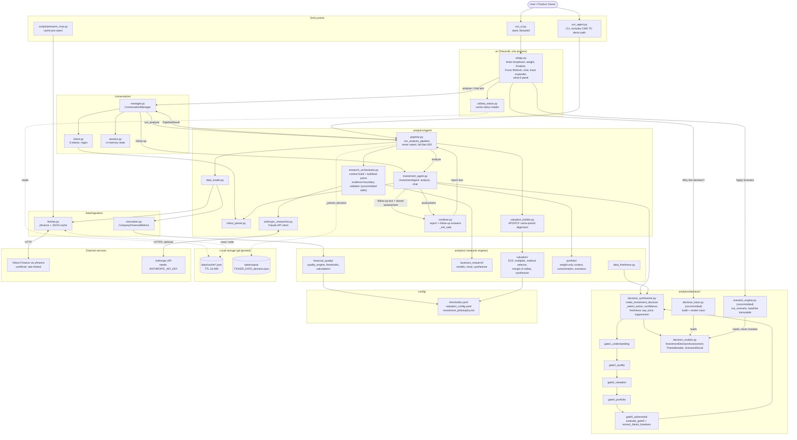
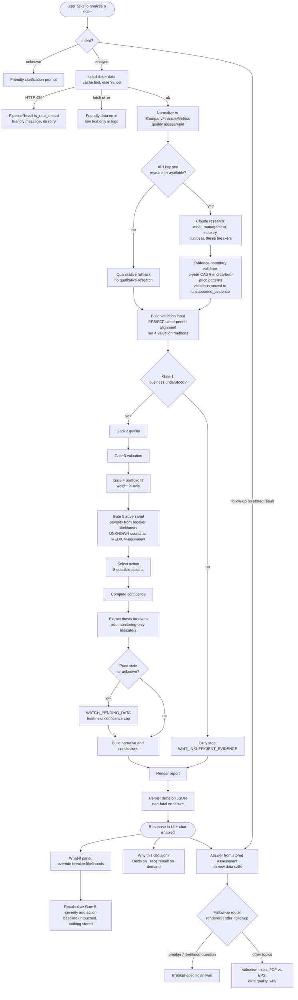
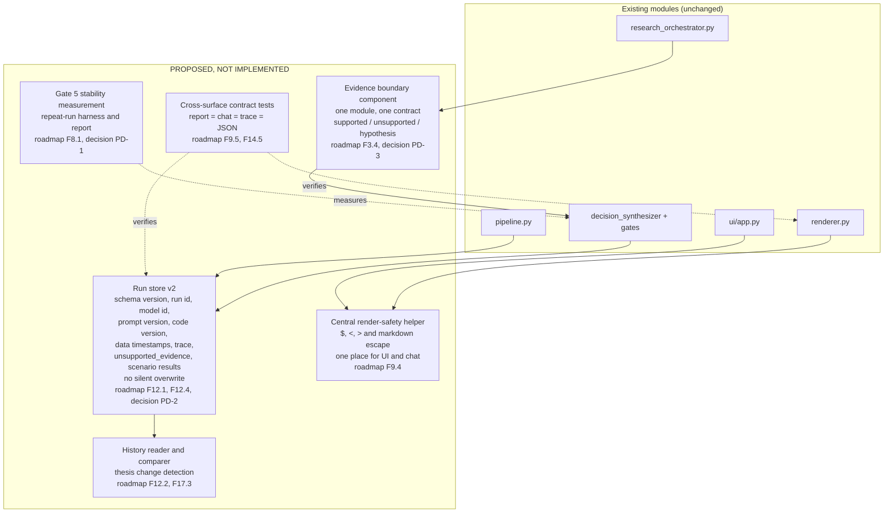

# Architecture Diagrams: Current Implementation and Proposed Target

| Field | Value |
|---|---|
| Last reviewed | 2026-10-11 |
| Baseline | `main` at `f6c3502` plus the uncommitted Phase 11A/11B working tree (14 modified, 6 untracked files) |
| Authoritative status | [Product Feature Inventory and Roadmap](../product/product-feature-inventory-and-roadmap.md) |
| Maintenance rules | [Roadmap Maintenance Protocol](../governance/roadmap-maintenance-protocol.md) |
| Complements | [Architecture Overview](architecture-overview.md) (Phase 10.6 narrative, ASCII), [Component Architecture](component-architecture.md), [Data Flow](data-flow.md) |

This document holds the maintained diagrams. The older overview documents describe Phase 10.6 and do not show the Decision Trace, scenario engine or Phase 11B evidence handling.

**Important reading notes**

- The product is **one Python process** (Streamlit) plus optional command-line scripts. Boxes are **modules and packages**, not services. There is no database, queue or network service of the product's own.
- Arrow legend: solid arrow = control flow or call; labelled "data" = object passed; dashed arrow = persistence or optional path.
- Modules marked `(uncommitted)` exist only in the working tree.
- Only the relationships I verified by reading code are drawn. The reading was deep for the pipeline, manager, agent, Gate 5, trace, scenario engine and synthesizer sequencing, and lighter for valuation and portfolio internals.

---

## Diagram A: Current implementation architecture

**What the diagram shows, and what it does not**

| Observation | Evidence |
|---|---|
| Pipeline is the only place that assembles the full sequence; manager and CLI both call it | `pipeline.py` header; `manager.py` header |
| Gates run in order 1, 2, 3, 4, 5, then `_select_action` | `decision_synthesizer.py:169-210` |
| `extract_thesis_breakers` runs after action selection; monitoring-only items are display-only | `decision_synthesizer.py:225`; `gate5_adversarial.py:284-312` |
| The UI calls the trace builder and scenario engine directly, bypassing the manager | `ui/app.py:391, 460` |
| The persisted JSON does not contain the trace, `unsupported_evidence` or scenario results | key list of persisted files; grep (FND-5, FND-10) |
| Scenario results and trace are recomputed on demand and never stored | no persistence call found |
| `.env.example` lists FMP, Alpha Vantage and Polygon keys but no code uses them, so those providers are **not** shown | grep |

---

## Diagram B: Decision-processing flow

**Failure and insufficient-evidence paths present in code:** rate-limit short-circuit, fetch error, Gate 1 early stop, missing API key (quantitative fallback leads to Gate 1 stop), stale/unknown price (WATCH_PENDING_DATA), persistence failure (logged, ignored), unknown intent (clarification).

**Known defect on this flow (FND-1):** in the working tree the follow-up router sends questions containing "why" and a word such as "lower" to the breaker-likelihood answer, so an FCF-vs-EPS question can return "No thesis breakers are recorded".

---

## Diagram C: Proposed target architecture (PROPOSED, NOT IMPLEMENTED)

Included because the current architecture has gaps that the roadmap already treats as work: persisted output lacks provenance and audit fields, evidence validation is scattered and pattern-based, rendering safety is per-call, and there are no cross-surface tests. **Nothing in this diagram exists today.** Every proposed element is tied to a roadmap item and is subject to owner decisions (PD-1 to PD-7).

| Proposed element | Why it is needed (evidence) | Roadmap item |
|---|---|---|
| Evidence boundary component | Two narrow patterns; fallback detected by label text; `unsupported_evidence` not persisted (FND-5) | F3.4 |
| Run store v2 | Same-day rerun overwrites; no provenance; trace and scenarios not stored (FND-10) | F12.1, F12.4 |
| History reader and comparer | CNQ.TO changed HOLD to REDUCE across runs and nothing records why (FND-3) | F12.2, F17.3 |
| Central render-safety helper | `_md_safe` escapes `<` and `>` only; `$` unhandled in 41 render calls (FND-4) | F9.4 |
| Cross-surface contract tests | 56 follow-up regressions reached the tree unnoticed (FND-1, FND-2) | F9.5 |
| Stability measurement | Gate 5 outcome varies with LLM-regenerated breakers (FND-3) | F8.1 |

Deliberately **not** proposed: a database server, a microservice split, an agent framework or a new UI stack. The evidence does not justify them for a single-user local tool.

---

## Key design decisions currently embodied in the code

| Decision | Where | Status |
|---|---|---|
| Sequential gates instead of a weighted score | `decision_synthesizer.py` | Implemented; validated by `test_decision.py` |
| Portfolio privacy: weight % only | `manager.py`, `portfolio_models.py` | Implemented; validated |
| Follow-ups reuse stored assessment, no new data calls | `investment_agent.py`, `renderer.py` | Implemented; **currently regressed** (FND-1) |
| Fail-fast on HTTP 429 in the interactive path | `pipeline.py` | Implemented; validated by unit tests |
| Scenario engine never mutates the baseline | `scenario_engine.py` | Implemented; validated |
| UNKNOWN likelihood is MEDIUM-equivalent for severity only | `gate5_adversarial.py` | Implemented; open question PD-1 |
| Monitoring-only breakers excluded from severity | `gate5_adversarial.py` | Implemented; awaiting live acceptance |

## Maintenance

Update the affected diagram **in the same work item** whenever a feature changes module boundaries, data flow, decision processing, persistence or interfaces (protocol step 6). Diagram C elements move into Diagram A only when the related roadmap item is Implemented **and** Validated; then remove the "PROPOSED" label for that element.

## Revision history

| Date | Change | Roadmap item(s) |
|---|---|---|
| 2026-10-11 | Initial diagrams from discovery review | F15.3 |
